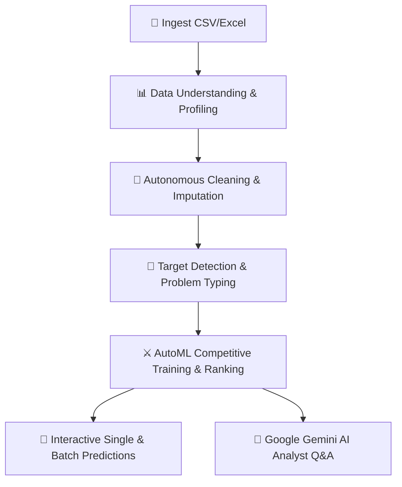

<div align="center">

# ⚡ ML DataSage AI
### Autonomous AutoML Pipeline & Intelligent Data Analyst Assistant

[](./LICENSE)
[](https://www.python.org/)
[](https://fastapi.tiangolo.com/)
[](https://react.dev/)
[](https://vitejs.dev/)
[](https://tailwindcss.com/)
[](https://ai.google.dev/)
[](https://render.com/)
[](./docker-compose.yml)

<p align="center">
  <b>Transform raw tabular datasets into optimized machine learning models in seconds — complete with AI-powered exploratory data analysis, automated cleaning, model benchmarking, real-time predictions, and interactive AI chat advisory.</b>
</p>

[Live Web App](https://automl-analyst-frontend.onrender.com) • [API Documentation](https://automl-analyst-backend-k0qn.onrender.com/docs) • [Deployment Guide](./DEPLOYMENT.md) • [Report Issue](https://github.com/technicalabinesh/ML-DataSage-AutoML/issues)

</div>

---

## 🌟 Overview

**ML DataSage AI** is an enterprise-ready, end-to-end Automated Machine Learning (AutoML) platform designed to eliminate repetitive data science workflows. From raw CSV/Excel ingest to model deployment and natural language querying, DataSage orchestrates the entire lifecycle through a modern, glassmorphic dark-mode web application.



---

## 🚀 Key Features

### 1. 📊 Deep Data Understanding & Automated Profiling
- Instant statistical profiling: row/column count, duplicate rate, data types, and missing value heatmaps.
- Automated distribution checks (skewness, variance, unique cardinality).
- Pre-packaged demo datasets (Telecom Churn, Housing Prices, Customer Segmentation) for immediate experimentation.

### 2. 🧹 Autonomous Data Cleaning & Preprocessing Engine
- **Missing Value Handling**: Configurable strategies including Median, Mean, Mode, or Row Dropping.
- **Outlier Mitigation**: Interquartile Range (IQR) capping and Z-score thresholding.
- **Categorical Encoding**: Automatic high-cardinality detection with One-Hot, Label, and Target encoding.
- **Feature Scaling**: RobustScaler, StandardScaler, and MinMaxScaler support.

### 3. 🎯 Problem & Target Detector
- Automatically infers whether a problem is **Binary Classification**, **Multi-class Classification**, or **Regression**.
- Heuristically suggests optimal target variables based on column semantics and statistical signatures.

### 4. ⚔️ Competitive AutoML Model Benchmarking
- Simultaneously trains and cross-validates multiple industry-standard algorithms:
  - 🌲 **LightGBM** (Light Gradient Boosting Machine)
  - ⚡ **XGBoost** (Extreme Gradient Boosting)
  - 🌳 **Random Forest** & **Gradient Boosting**
  - 📈 **Linear / Ridge / Lasso Regression** & **Logistic Regression**
- Interactive leaderboard ranked by standard metrics:
  - **Classification**: Accuracy, Precision, Recall, F1-Score, ROC-AUC.
  - **Regression**: $R^2$ Score, RMSE, MAE, MSE.

### 5. 🎯 Production Prediction Interface
- **Real-Time Single Record Inference**: Dynamically generates input forms based on the dataset schema to test hypotheses instantly.
- **Batch CSV Inference**: Upload unseen batch CSV files and download enriched predictions with confidence probabilities.
- Model serialization & artifact persistence using `joblib`.

### 6. 🤖 Google Gemini AI Data Analyst
- Conversational assistant powered by Google Gemini (`gemini-2.5-flash` / `gemini-1.5-pro`).
- Ask plain-English questions about data anomalies, feature correlations, and algorithmic decisions.
- Executive AI summaries generating actionable business intelligence and next steps.

---

## 🛠️ Architecture & Tech Stack

| Layer | Technology | Key Libraries / Frameworks |
|---|---|---|
| **Frontend** | React 19 + Vite 8 | Tailwind CSS, Lucide Icons, Recharts, Axios |
| **Backend API** | Python 3.11 + FastAPI | Uvicorn, Pydantic v2, Gunicorn |
| **ML & Data Processing** | Python Data Science Stack | Pandas, NumPy, Scikit-Learn, LightGBM, XGBoost, Joblib |
| **Generative AI** | Google GenAI SDK | Google Gemini 2.5 Flash / 1.5 Pro |
| **Containerization** | Docker | Multi-stage Dockerfiles, Docker Compose |
| **Cloud Hosting** | Render | Render Blueprints (Infrastructure as Code) |

---

## 📁 Repository Structure

```plaintext
ML-DataSage-AutoML/
├── backend/                        # FastAPI Backend Service
│   ├── ai_analyst.py               # Gemini AI Chat & Executive Summary Engine
│   ├── data_cleaning.py            # Missing value, outlier & encoding engine
│   ├── data_understanding.py       # Statistical profiling & summary engine
│   ├── dataset_manager.py          # Session and in-memory dataframe cache
│   ├── main.py                     # API router endpoints and CORS config
│   ├── ml_engine.py                # Model training, cross-validation & ranking
│   ├── prediction_engine.py        # Single/batch inference & pipeline export
│   ├── problem_detector.py         # Classification vs Regression inference
│   ├── sample_data/                # Preloaded sample datasets & generator
│   └── saved_models/               # Persisted model pipeline artifacts
├── frontend/                       # React 19 + Vite 8 Web Client
│   ├── src/
│   │   ├── components/             # Step-by-step pipeline views
│   │   │   ├── Header.jsx          # Model selector & navigation bar
│   │   │   ├── UploadStep.jsx      # CSV/Excel drag & drop uploader
│   │   │   ├── UnderstandingStep.jsx # Data distribution & summary cards
│   │   │   ├── CleaningStep.jsx    # Preprocessing controls & report
│   │   │   ├── ProblemStep.jsx     # Problem type & target selection
│   │   │   ├── TrainingStep.jsx    # Leaderboard & training progress
│   │   │   ├── PredictionStep.jsx  # Interactive form & batch predictions
│   │   │   └── AIChatStep.jsx      # Gemini chat analyst assistant
│   │   ├── App.jsx                 # Master pipeline state coordinator
│   │   └── index.css               # Modern dark-mode styling
│   └── package.json
├── tests/                          # Automated backend test suite
│   └── test_automl.py              # Pipeline unit & integration tests
├── Dockerfile.backend              # Production container for FastAPI
├── Dockerfile.frontend             # Production Nginx container for React
├── docker-compose.yml              # Local multi-container orchestration
├── render.yaml                     # Render Blueprint (Infrastructure-as-Code)
├── requirements.txt                # Python backend dependencies
├── DEPLOYMENT.md                   # Full step-by-step deployment guide
└── README.md                       # Project documentation
```

---

## ⚡ Quickstart (Local Development)

### Prerequisites
- **Python 3.11+**
- **Node.js 20+** or **Node.js 22 LTS**
- (Optional) **Google Gemini API Key** from [Google AI Studio](https://aistudio.google.com/)

### 1. Clone the Repository
```bash
git clone https://github.com/technicalabinesh/ML-DataSage-AutoML.git
cd ML-DataSage-AutoML
```

### 2. Run the Backend API
```bash
# Create and activate virtual environment
python -m venv venv
# Windows:
.\venv\Scripts\activate
# Linux/macOS:
source venv/bin/activate

# Install dependencies
pip install -r requirements.txt

# (Optional) Export your Gemini API Key
export GEMINI_API_KEY="your_api_key_here"   # On Windows: $env:GEMINI_API_KEY="your_key"

# Start the server
uvicorn backend.main:app --host 127.0.0.1 --port 8000 --reload
```
API Documentation will be live at `http://127.0.0.1:8000/docs`.

### 3. Run the Frontend Client
```bash
# In a new terminal window
cd frontend

# Install dependencies
npm install

# Start development server
npm run dev
```
Open `http://localhost:5173` in your browser.

---

## 🐳 Running with Docker

Run the entire production stack locally with one command:

```bash
docker compose up --build
```

- **Web Application**: `http://localhost:80`
- **Backend API**: `http://localhost:8000`
- **Interactive Swagger Docs**: `http://localhost:8000/docs`

---

## ☁️ 1-Click Cloud Deployment (Render Blueprint)

This repository includes a production-ready [`render.yaml`](./render.yaml) specification configured for Render's **Free Tier**:

1. Fork or push this repository to your GitHub account.
2. Navigate to the [Render Dashboard](https://dashboard.render.com).
3. Click **New +** $\rightarrow$ **Blueprint**.
4. Connect `technicalabinesh/ML-DataSage-AutoML`.
5. Enter your `GEMINI_API_KEY` when prompted and click **Apply**.

Render automatically provisions:
- `automl-analyst-backend`: Python 3.11 FastAPI web service.
- `automl-analyst-frontend`: High-performance React static site on global CDN.

For in-depth troubleshooting and configuration details, read [DEPLOYMENT.md](./DEPLOYMENT.md).

---

## 🧪 Running Automated Tests

Run the backend unit tests across data understanding, cleaning, problem detection, and model training:

```bash
# In root directory with virtualenv active
$env:PYTHONPATH="." ; python tests/test_automl.py
```

All 7 test suites validate end-to-end pipeline integrity before deployment.

---

## 🤝 Contributing

Contributions, feedback, and feature requests are welcome!

1. Fork the Project
2. Create your Feature Branch (`git checkout -b feature/AmazingFeature`)
3. Commit your Changes (`git commit -m 'feat: Add AmazingFeature'`)
4. Push to the Branch (`git push origin feature/AmazingFeature`)
5. Open a Pull Request

---

## 📄 License

Distributed under the **MIT License**. See [`LICENSE`](./LICENSE) for more information.

---

<div align="center">
  <b>Crafted with ❤️ by <a href="https://github.com/technicalabinesh">Abinesh</a></b>
</div>